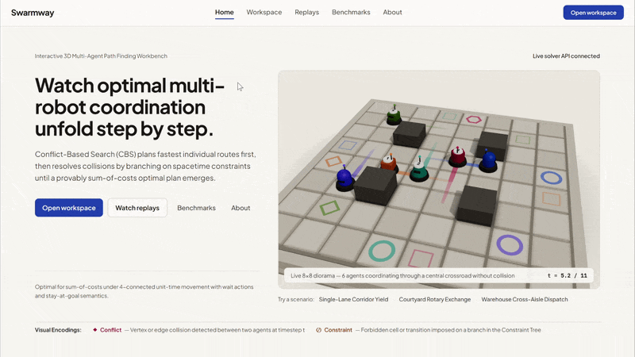
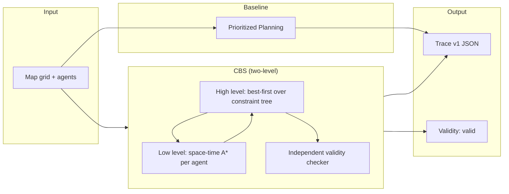

# Swarmway

<div align="center">
  
  
  
  
  
  
  
</div>

<p align="center">
  <strong>Interactive 3D workbench for optimal multi-agent path finding (MAPF).</strong>
</p>

<p align="center">
  Conflict-Based Search · Independent validity checker · Brute-force optimality · Property suite · Benchmark harness
</p>

<p align="center">
  <a href="#overview">Overview</a> ·
  <a href="#architecture">Architecture</a> ·
  <a href="#tech-stack">Tech stack</a> ·
  <a href="#benchmarks">Benchmarks</a> ·
  <a href="#local-development">Run locally</a> ·
  <a href="#deployment">Deploy</a>
</p>

---

## Overview

Swarmway is an interactive study of **Conflict-Based Search (CBS)** — the standard *optimal* algorithm for multi-agent path finding. CBS is optimal for **sum-of-costs** (the sum, over every agent, of the timestep at which it permanently reaches its goal) under 4-connected unit-time movement with wait actions and stay-at-goal semantics. That "optimal" is a measured claim, backed by an independent validity checker, brute-force cross-checks, and a property suite — never a slogan.

The Prioritized Planning (PP) baseline plans agents sequentially: faster in open space, but neither optimal nor complete — earlier agents can seal narrow corridors or block goals needed by later agents. Swarmway lets you see both side by side on the same instance.

<table>
  <tr>
    <td width="33%" valign="top"><strong>01 · Solve optimally</strong><br />CBS two-level constraint tree with space-time A* low level. Every solution re-checked by an independent validity checker before returning.</td>
    <td width="33%" valign="top"><strong>02 · Watch the search</strong><br />3D playback of collision-free paths; step through constraint-tree conflicts, branches, and re-plans one timestep at a time.</td>
    <td width="33%" valign="top"><strong>03 · Compare honestly</strong><br />CBS vs. Prioritized on the same instance, both numbers labelled. Baseline caveat shown verbatim: "Incomplete baseline: faster, sometimes fails, usually costlier."</td>
  </tr>
  <tr>
    <td width="33%" valign="top"><strong>04 · Benchmark reproducibly</strong><br />Config-driven benchmark harness, committed artifacts under data/results/&lt;run-id&gt;/. Every number cites a run ID. No hand-typed figures.</td>
    <td width="33%" valign="top"><strong>05 · Edit instances</strong><br />Custom-grid editor: paint obstacles, place agents start→goal, share via RLE+base64url URL hash, localStorage draft persistence.</td>
    <td width="33%" valign="top"><strong>06 · Offline-first</strong><br />Deployed site works with no backend — bundled traces + benchmarks play immediately. Honest "pre-computed examples" badge.</td>
  </tr>
</table>

### Core workflow

```text
Pick map  ->  Place agents  ->  Solve (CBS)  ->  Play/scrub  ->  Search tab: step to conflict
     Map picker      Click-to-place     Constraint tree        3D stage           CT branches
```

The repository contains the complete path across the solver, API, benchmark harness, frontend, CI, and documentation.

**Deployed site:** https://swarm-way.vercel.app/ (offline-first — works with no backend; bundled traces + benchmarks play immediately).

**Demo video:** https://youtu.be/No3Ur-CroiA (3-5 min walkthrough of the deployed site: warehouse @20 → Solve (CBS) → play/scrub → Search tab conflict branching → Compare with Prioritized → Benchmarks page with run ID).



---

## Why Swarmway

MAPF appears in warehouse robotics, drone swarms, and game AI, yet the gap between "CBS is optimal" (a theorem) and "here is what optimal actually looks like step by step" is wide. Swarmway closes it:

- **See the search, not just the result.** The Search tab steps through the constraint tree: conflicts, branches, and re-plans, one timestep at a time.
- **Honest comparison.** CBS vs. Prioritized on the same instance, with both numbers labelled and the baseline caveat shown verbatim.
- **Reproducible numbers.** Every benchmark figure comes from a committed artifact directory under `data/results/<run-id>/`; none is hand-typed.

---

## Architecture

Swarmway separates the solver (pure Python, auditable, no C extensions) from the API and frontend via a frozen trace/API contract. The frontend is a pure client-side SPA that works offline.

### Solver pipeline



### Constraint tree branching

```mermaid
flowchart TD
  Root[Root node: unconstrained paths] --> Check{First conflict?}
  Check -->|None| Leaf[Conflict-free solution (leaf)]
  Check -->|Vertex/edge conflict| Branch[Branch: two children]
  Branch --> C1[Child A: constrain agent 1]
  Branch --> C2[Child B: constrain agent 2]
  C1 --> Check
  C2 --> Check
  Leaf --> Pop[Best-first pops min-SoC leaf]
```

### Runtime responsibilities

| Boundary | Responsibility | Source |
| --- | --- | --- |
| Solver | Pure Python CBS + PP, space-time A*, validity checker | `src/swarmway/solver/` |
| API | FastAPI + Pydantic, caps, 422 details | `src/swarmway/api/` |
| Frontend | React SPA, 3D playback, tree explorer, instance editor | `frontend/src/` |
| Benchmarks | Config-driven runner, artifacts, sync | `src/swarmway/bench/` |
| Hosting | Vercel (frontend, static); Render (backend, Docker) | `vercel.json`, `Dockerfile` |

---

## Tech Stack

| Layer | Choice | Why | Alternative |
| --- | --- | --- | --- |
| Runtime | Python 3.12+, `uv` | Fast, lockfile-accurate envs; pure-Python, portable | poetry, pip+venv |
| Language | Python (mypy-checked) backend; TypeScript frontend | Types are the first line of correctness | |
| Solver | Pure Python: `heapq`, `dataclasses`. No C extensions in MVP | Auditable, portable | Rust/C++ core (future) |
| API | FastAPI + Pydantic v2 + uvicorn | OpenAPI contract, validation at the boundary | Litestar |
| Tests | pytest + hypothesis + httpx | Property-based testing for solver invariants | |
| Quality | ruff (lint+format), mypy (strict on `solver/`, `domain/`), pre-commit | Machine-enforced discipline | |
| Frontend | React + TypeScript + Vite SPA; 3D via React Three Fiber (`three` + `@react-three/fiber` + `@react-three/drei`) | User-chosen 3D path for generated code | Hand-written Three.js |
| Frontend styling | Tailwind CSS | Low-friction for generated code | CSS modules |
| CI | GitHub Actions (backend + frontend jobs) | Free for public repos | |
| Hosting | Vercel (frontend, static); Render (backend, Docker) | Zero cost, works offline | |

Versions are latest stable at build time, recorded in `docs/decisions/ADR-0002-versions.md`. Decisions are recorded as ADRs in `docs/decisions/` (ADR-0001…ADR-0010).

---

## How do you know it's correct?

- **Independent validity checker** (`solver/validity.py`): every solution CBS returns is re-checked collision-free before `solve()` returns; an invalid solution aborts the run.
- **Brute-force cross-checks:** CBS vs. brute force on hand-crafted corridors, swaps, forced detours, and random tiny instances — `soc_cbs == soc_bruteforce` whenever brute force finds a solution (`tests/optimality/test_optimality.py`).
- **Property suite** (Section 9.2): validity, dominance, determinism, unsat-honesty, parser round-trip, heuristic admissibility — run locally at `max_examples=200`, all green.
- **Low-level tests:** space-time A* cost equals an independent exhaustive BFS over the time-expanded graph; true-distance tables cross-checked against BFS.

**Argument summary:** CBS is a best-first search over a constraint tree whose leaves include every conflict-free solution, so the first conflict-free node popped has minimal sum-of-costs (Sharon et al. 2015, §3.1). Full write-up: `docs/correctness-argument.md`.

---

## Benchmarks

Headline results embedded from `data/results/20261105-1754-5db8a24-dirty-headline/table.md` (run ID `20261105-1754-5db8a24-dirty-headline`; 60 s budget per solve). Full per-cell rows in the committed artifact directory; nothing here is hand-typed.

**Environment record:** CPython 3.12.15, Windows 11, 16.5 GB RAM, `git describe: 5db8a24-dirty`, `2026-11-05T17:54:21+00:00` (`frontend/public/benchmarks/environment.json`).

| arm | solved | timeout | unsat | success rate | median SoC (solved) | median runtime ms (solved) |
| --- | --- | --- | --- | --- | --- | --- |
| CBS (optimal) | 13 / 24 | 11 | 0 | 0.54 | 226 | 24.4 |
| Prioritized (baseline) | 20 / 24 | 3 | 1 | 0.83 | 336.5 | 982.6 |
| Prioritized best-of-8 | 15 / 24 | 9 | 0 | 0.62 | 242 | 5714.2 |
| **All arms** | **48 / 72** | **23** | **1** | — | — | — |

**Honest reporting** (verbatim, Sections 1.6 / 10.6):

- Timeouts are **failures** and stay in the success-rate denominators — never dropped. CBS times out on 11 of 24 cells.
- Medians are computed over **solved runs only**, with the solved-count shown next to each median.
- Artifacts are **not comparable across machines** — per-environment tables only (Section 10.4).
- Every number on this page cites the run ID above; no figure is hand-typed (Section 10.7).

A second ("rerun") execution confirmed statuses/SoCs/makespans are reproducible (runtimes vary, as expected); see `data/results/20261105-1835-5db8a24-dirty-rerun/` and the `swarmway bench --diff` output in `docs/verification/phase-8.md`.

**Reproduce:** `uv run swarmway bench --config bench/default.yaml` — then `scripts/sync-results.py` to bundle `summary.json` into `frontend/public/benchmarks/`. Full procedure: `docs/benchmark-protocol.md`. The Benchmarks page renders `frontend/public/benchmarks/summary.json` with no backend required.

---

## Tech stack (as actually built)

| Layer | Choice | Why |
| --- | --- | --- |
| Runtime | Python 3.12+, `uv` | Fast, lockfile-accurate envs; pure-Python, portable |
| Language | Python (mypy-checked) backend; TypeScript frontend | Types as first line of correctness |
| Solver | Pure Python (`heapq`, `dataclasses`), no C extensions | Auditable, portable |
| API | FastAPI + Pydantic v2 + uvicorn | OpenAPI contract, validation at the boundary |
| Tests | pytest + hypothesis + httpx | Property-based testing for solver invariants |
| Quality | ruff (lint+format), mypy strict, pre-commit | Machine-enforced discipline |
| Frontend | React + TypeScript + Vite SPA; React Three Fiber (`three`, `@react-three/fiber`, `@react-three/drei`) | User-chosen 3D path for generated code |
| Frontend styling | Tailwind CSS | Low-friction for generated code |
| CI | GitHub Actions (backend + frontend jobs) | Free for public repos |
| Hosting | Vercel (frontend, static); Render (backend, Docker) | Zero cost, works offline |

Versions are latest stable at build time, recorded in `docs/decisions/ADR-0002-versions.md`. Decisions are recorded as ADRs in `docs/decisions/` (ADR-0001…ADR-0010).

---

## Run it locally

**Backend (3 commands):**

```bash
uv sync
uv run uvicorn swarmway.api.app:app   # :8000
# in another shell:
VITE_API_BASE_URL=http://localhost:8000 cd frontend && pnpm run dev
```

**Frontend offline (no backend):** `cd frontend && pnpm run dev` — the site detects the absent backend, shows the honest offline badge, and plays bundled traces + benchmarks.

**Benchmark:** `uv run swarmway bench --config bench/default.yaml` (headline run; ~15–75 min locally).

I followed the backend quickstart once, fresh, in a clean shell: `uv sync` then `uv run uvicorn swarmway.api.app:app` started `:8000`, `GET /api/health` returned `{"status":"ok","solvers":["cbs","pp-best-of-n","pp-fixed"],...}`, and a live CBS solve returned a valid trace within budget. (Full smoke transcript recorded in `docs/verification/phase-9.md`.)

---

## Repository tour

- `src/swarmway/domain/` — grid, agents, instance, movement model; imports nothing from `solver/`, `api/`, or `frontend/` (purity rule).
- `src/swarmway/solver/` — space-time A* low level, CBS high level, Prioritized Planning, trace recording, independent validity checker; imports only `domain/`.
- `src/swarmway/api/` — FastAPI app: `GET /api/health`, `POST /api/solve` with server-side caps and detailed 422s.
- `src/swarmway/cli/` — `swarmway solve | parse | replay | bench`.
- `src/swarmway/bench/` — config-driven runner, aggregators, artifact writers (`config.yaml`, `environment.json`, `results.csv`, `summary.json`, `table.md`), `scripts/sync-results.py`.
- `tests/` — unit, property (hypothesis), optimality (brute-force), integration (API caps/errors).
- `frontend/` — React SPA: workspace, search tree explorer, compare panel, instance editor, replays gallery, benchmarks page; all strings in `frontend/src/strings.ts`; bundled traces + benchmarks for offline use.
- `data/maps/`, `data/scenarios/` — vendored MovingAI MAPF grids/scenarios (ODC-BY; see `docs/data-attribution.md`).
- `data/results/<run-id>/` — committed benchmark artifacts (headline run + rerun).
- `docs/` — phase gates `phase-0…phase-9.md`, ADRs, benchmark protocol, correctness argument, data attribution.
- `Makefile` — `verify`, `bench-default`.

---

## Data & attribution

Grid maps and scenario files vendored under `data/maps/` and `data/scenarios/` come from the Moving AI Lab MAPF benchmarks (https://movingai.com/benchmarks/mapf.html), distributed under the **Open Data Commons Attribution License (ODC-BY)**. Academic citation:

```bibtex
@article{stern2019mapf,
  title={Multi-Agent Pathfinding: Definitions, Variants, and Benchmarks},
  author={Roni Stern and Nathan R. Sturtevant and Ariel Felner and Sven Koenig
          and Hang Ma and Thayne T. Walker and Jiaoyang Li and Dor Atzmon and
          Liron Cohen and T. K. Satish Kumar and Eli Boyarski and Roman Bartak},
  journal={Symposium on Combinatorial Search (SoCS)},
  year={2019},
  pages={151--158}
}
```

Per ODC-BY, Swarmway may copy, distribute, and use the data provided the source is attributed — this README plus `docs/data-attribution.md` is that attribution. Derived results (benchmark tables, traces) note the source in their artifact headers.

- **Code licence:** MIT (`LICENSE`).
- **Data licence:** ODC-BY. Citation block: [S2] Stern et al. 2019 (SoCS); [S3] Moving AI Lab MAPF benchmarks page; [S4] ODC-BY license text.

Full file-by-file provenance: `docs/data-attribution.md`.

---

## How this was built

Backend (`domain/`, `solver/`, `api/`, `cli/`, `bench/`, tests, CI, docs) was implemented directly by the coding agent, directed by the human. The frontend (`frontend/`) was human-directed: generated in Google AI Studio Build mode and then completed/directly maintained by the agent after AI Studio Build-mode tokens were exhausted (ADR-0009). Every phase has a committed verification gate in `docs/verification/phase-0…phase-9.md` with real command output, and every deviation from the plan is recorded as an ADR — that record is the evidence, not a claim.

AI Studio tokens were exhausted during Phase 6, so Phase 6+ frontend work (search tree explorer, compare panel, instance editor, benchmarks page) was built directly in `frontend/` on the sessions-12-13 exported state, under the same frozen contract/copy rules (ADR-0009).

---

## What's next (Section 19)

- Issues, star-friendly README tweaks, and — if the results write-up grows — a workshop-note thread.
- Future solver scope: Rust/C++ core (optional perf guardrail), PyPy compatibility, additional tie-breaks.
- Frontend: Playwright e2e in CI (currently manual checklist), more bundled traces.

---

## Licence

- **Code:** MIT (`LICENSE`).
- **Data (vendored maps/scenarios):** ODC-BY, attributed in `docs/data-attribution.md` with citation [S2][S3][S4].

---

*Swarmway — built with AI assistance. Every number cites a run ID.*

**Deployed:** https://swarm-way.vercel.app/  **Video:** https://youtu.be/No3Ur-CroiA
